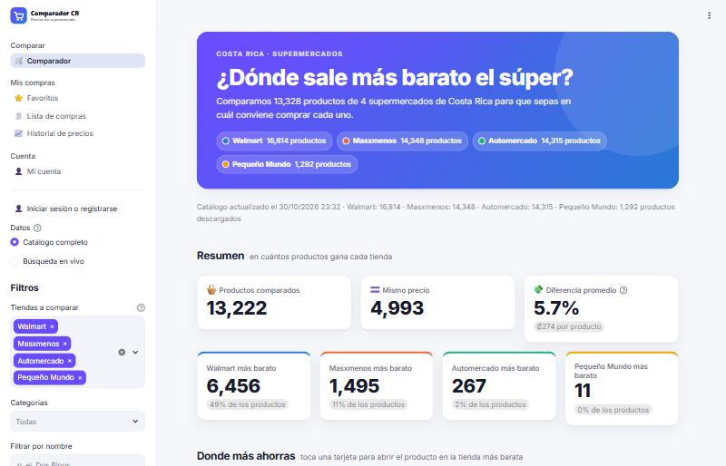
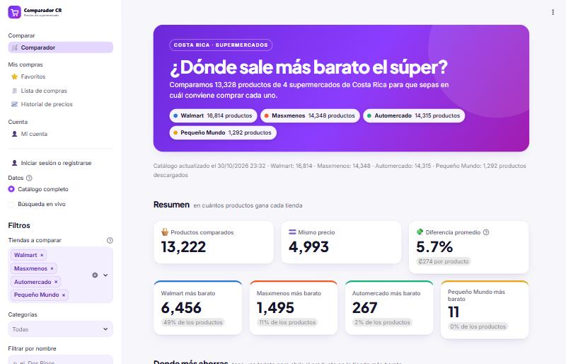
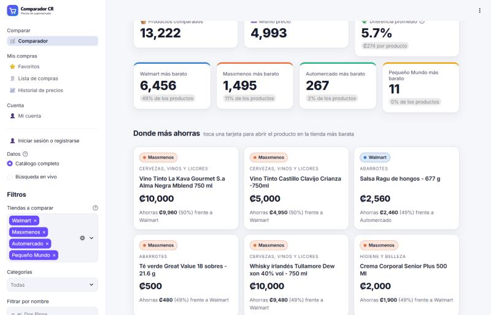
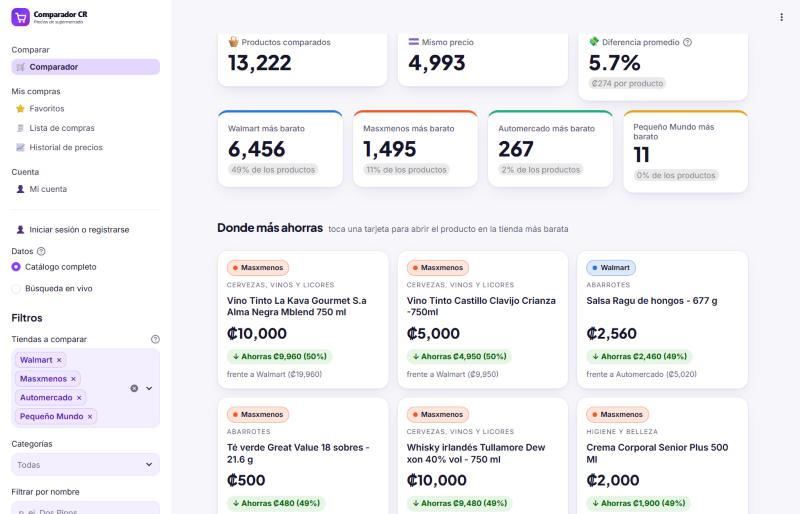
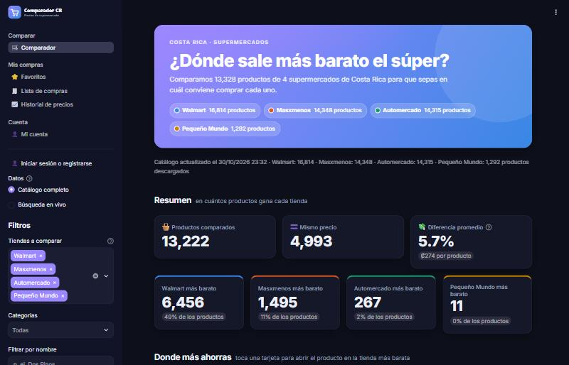
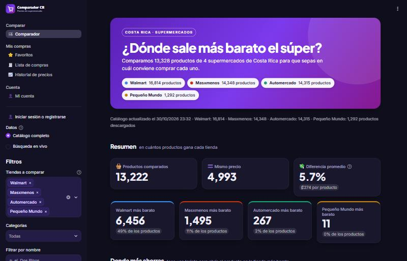

# Auditoría de colorimetría

Revisión de todos los colores de la app (31/10/2026). Se midió:
- el contraste de cada texto con su fondo;
- si los elementos gráficos se distinguen del fondo;
- si los colores de las tiendas se distinguen entre sí, también con daltonismo.

Con esos resultados se rediseñó la paleta para que la app sea más llamativa sin saturar. Hay un solo bloque de color intenso por pantalla (la portada), las superficies son limpias y el color queda reservado para lo que significa algo: la tienda o el ahorro.

## Resumen

| | Antes | Después |
|---|---|---|
| Pares de colores que no cumplían | **19** (8 en claro, 11 en oscuro) | **0** de 90 medidas |
| Validador de paletas del skill de visualización (4 tiendas, todos los pares) | Falla en claro y en oscuro | Pasa en claro y en oscuro |
| Texto de la portada en modo oscuro | 2.88:1, por debajo del mínimo de 4.5:1 | 5.70:1 |
| ¿La marca se parecía a una tienda? | Sí: el degradado terminaba en el azul de Walmart | No: violeta/fucsia, a ΔE ≥ 17 de todas |

Quedan **2 excepciones a propósito**, solo en modo claro: el aqua de Automercado (2.82:1) y el ámbar de Pequeño Mundo (2.17:1) sobre blanco, como gráfico. Son colores de identidad y no se oscurecen para no perder su tono. Se compensan escribiendo siempre el nombre de la tienda al lado: en insignias, leyendas, etiquetas de los gráficos y la tabla.

## Método

- **Contraste WCAG 2.2.** El texto pide al menos 4.5:1 (3:1 en títulos grandes) y los elementos gráficos al menos 3:1. Las transparencias se miden ya mezcladas con su fondo; por ejemplo, las píldoras blancas al 94% sobre cada parada del degradado.
- **Separación entre colores.** Se mide la distancia ΔE en OKLab (×100). Para que dos tiendas se distingan de un vistazo hacen falta 15 o más con visión normal, y 8 o más simulando protanopía y deuteranopía (matrices de Machado, Oliveira y Fernandes, 2009). La tritanopía, muy poco común, se informa pero no se exige, igual que en el validador del skill.
- **Validador del skill de visualización** (`validate_palette.py`). Se corrió sobre los cuatro colores de tienda con `--pairs all`, porque en esta app cualquier tienda puede quedar al lado de cualquier otra (en barras, insignias y tarjetas).
- **Reproducible.** `python colorimetria.py` imprime las tablas de abajo. [`test_colorimetria.py`](../test_colorimetria.py) falla si un cambio de color rompe algún mínimo, o si `.streamlit/config.toml` deja de coincidir con [`paleta.py`](../paleta.py).

## Hallazgos y cambios

| Medida | Claro antes | Oscuro antes | Claro después | Oscuro después |
|---|---|---|---|---|
| Texto de la portada (parada más justa del degradado) | 4.42:1 ❌ | 2.88:1 ❌ | 4.99:1 | 5.70:1 |
| Texto bajo el círculo decorativo de la portada | 3.73:1 ❌ | 3.16:1 ❌ | 5.40:1 | 6.75:1 |
| Píldoras de tiendas en la portada | 3.38:1 ❌ | 2.39:1 ❌ | 16.24:1 | 16.19:1 |
| Texto de botones principales | 5.13:1 | 2.88:1 ❌ | 4.99:1 | 4.99:1 |
| Etiquetas del filtro de tiendas | 5.13:1 | 2.88:1 ❌ | 7.50:1 | 9.74:1 |
| Marca vs. azul de Walmart (ΔE) | 12.9 ❌ | 12.1 ❌ | 17.2 | 17.9 |
| Final del degradado vs. Walmart (ΔE) | 0.0 ❌ | 0.0 ❌ | 17.1 | 17.5 |
| Masxmenos vs. Pequeño Mundo (ΔE) | 13.7 ❌ | 10.6 ❌ | 16.1 | 16.2 |
| Masxmenos vs. Pequeño Mundo con daltonismo (ΔE) | 9.8 | 4.9 ❌ | 10.1 | 11.5 |

Qué se decidió y por qué:

1. **Marca violeta → fucsia.** Las tiendas ya ocupan el azul, el naranja, el aqua y el ámbar; el violeta y el fucsia son los únicos tonos vistosos que no se confunden con ninguna. Antes el degradado terminaba exactamente en el azul de Walmart y la app parecía "de" esa tienda.
2. **Un mismo violeta (`#8b3dff`) para los botones en claro y en oscuro.** Con texto blanco da 4.99:1 y se distingue de ambos fondos (4.7:1 y 3.8:1). El violeta claro que se usaba antes en modo oscuro dejaba el texto de los botones en 2.88:1.
3. **Portada en tres paradas y texto blanco sin opacidad.** El texto tenía una opacidad del 85–92% que bajaba el contraste sin que se notara. Las píldoras de las tiendas pasan a ser blancas con texto oscuro (de 2.4:1 a 16:1).
4. **Masxmenos y Pequeño Mundo con otro paso de su misma escala.** El validador fallaba porque el naranja y el amarillo quedaban demasiado cerca; en modo oscuro, con deuteranopía, eran casi iguales (4.9). Se buscaron en OKLCH las variantes más parecidas a las originales que pasan todas las validaciones. Walmart y Automercado no cambian.
5. **Verde solo para ahorros, siempre con flecha y texto** («↓ Ahorras ₡9,960 (50%)»). En claro es el color de estado "bien" de la paleta de referencia (`#006300`). En oscuro se usa un verde más claro (`#4ade80`) para separarlo del aqua de Automercado.
6. **Menos saturación.** Las tiendas elegidas en el filtro eran cuatro píldoras violetas sólidas; ahora tienen un tinte suave con texto violeta oscuro. Los fondos son neutros con un toque violeta, y las sombras y los bordes son finos.
7. **Etiquetas directas en los gráficos.** Cada barra dice la tienda ("50% · Masxmenos") y cada línea del historial termina con su nombre. Los puntos llevan un aro del color del fondo para separarse cuando se tocan.
8. **Tipografía.** Plus Jakarta Sans para títulos y cifras grandes, Inter para el texto.

## Paleta final

La paleta está definida en [`paleta.py`](../paleta.py). Los colores base se repiten en [`.streamlit/config.toml`](../.streamlit/config.toml) para los controles de Streamlit.

| Token | Claro | Oscuro | Uso |
|---|---|---|---|
| Fondo | `#f7f7fb` | `#0f0e1c` | Fondo de la página |
| Superficie | `#ffffff` | `#18172c` | Tarjetas, métricas, gráficos |
| Barra lateral | `#ffffff` | `#131224` | Menú y filtros |
| Borde | `#e8e7f1` | `#2b2946` | Bordes finos de tarjetas y controles |
| Texto | `#16142b` | `#eeedf9` | Texto principal y cifras |
| Texto secundario | `#5d5a78` | `#a7a4c6` | Etiquetas, notas, ejes de los gráficos |
| Primario | `#8b3dff` | `#8b3dff` | Botones, selección, controles activos |
| Enlaces | `#6d28d9` | `#c4b5fd` | Enlaces de texto |
| Degradado de la portada | `#6d28d9 → #8b3dff → #a21caf` | `#5b21b6 → #7c3aed → #86198f` | Portada (texto blanco encima) |
| Tinte de la marca | `#f4efff` | `#231c47` | Perfil del usuario en la barra lateral |
| Etiquetas (fondo) | `#efe7ff` | `#2e2160` | Tiendas elegidas en el filtro |
| Etiquetas (texto) | `#5b21b6` | `#ddd1ff` | Texto de esas etiquetas |
| Ahorro | `#006300` | `#4ade80` | «↓ Ahorras ₡…» (siempre con texto) |
| Ahorro (fondo) | `#e7f5e7` | `#13281d` | Píldora del ahorro |
| Rejilla | `#ebeaf2` | `#262540` | Líneas guía de los gráficos |

Colores de las tiendas:

| Tienda | Claro antes → después | Oscuro antes → después |
|---|---|---|
| Walmart | `#2a78d6` → `#2a78d6` | `#3987e5` → `#3987e5` |
| Masxmenos | `#eb6834` → `#f15a25` | `#d95926` → `#bd3311` |
| Automercado | `#1baf7a` → `#1baf7a` | `#199e70` → `#199e70` |
| Pequeño Mundo | `#eda100` → `#e8a317` | `#c98500` → `#c17f11` |

Resultado del validador del skill después del cambio (`--pairs all`):

- **Claro:** pasan la banda de luminosidad, el croma, el daltonismo (peor par ΔE 9.2) y la visión normal (peor par ΔE 16.1). El aqua y el ámbar quedan bajo 3:1 sobre blanco y llevan el nombre escrito (regla de alivio).
- **Oscuro:** pasa todo, incluido el contraste de 3:1 o más de las cuatro tiendas. El peor par con daltonismo da ΔE 8.9 y con visión normal 16.2.

## Medidas completas (después)

### Tema claro

| Par | Colores | Medida | Mínimo | Estado |
|---|---|---|---|---|
| Texto sobre fondo | `#16142b` / `#f7f7fb` | 16.81:1 | 4.5:1 | ✅ |
| Texto secundario sobre fondo | `#5d5a78` / `#f7f7fb` | 6.14:1 | 4.5:1 | ✅ |
| Texto sobre superficie | `#16142b` / `#ffffff` | 17.96:1 | 4.5:1 | ✅ |
| Texto secundario sobre superficie | `#5d5a78` / `#ffffff` | 6.56:1 | 4.5:1 | ✅ |
| Texto sobre barra | `#16142b` / `#ffffff` | 17.96:1 | 4.5:1 | ✅ |
| Texto secundario sobre barra | `#5d5a78` / `#ffffff` | 6.56:1 | 4.5:1 | ✅ |
| Enlaces sobre fondo | `#6d28d9` / `#f7f7fb` | 6.65:1 | 4.5:1 | ✅ |
| Ahorro (texto verde) sobre tarjeta | `#006300` / `#ffffff` | 7.54:1 | 4.5:1 | ✅ |
| Ahorro sobre su píldora | `#006300` / `#e7f5e7` | 6.68:1 | 4.5:1 | ✅ |
| Texto sobre el perfil | `#16142b` / `#f4efff` | 15.94:1 | 4.5:1 | ✅ |
| Texto secundario sobre el perfil | `#5d5a78` / `#f4efff` | 5.83:1 | 4.5:1 | ✅ |
| Texto de la portada sobre el degradado (1/3) | `#ffffff` / `#6d28d9` | 7.1:1 | 4.5:1 | ✅ |
| Texto de la portada sobre el degradado (2/3) | `#ffffff` / `#8b3dff` | 4.99:1 | 4.5:1 | ✅ |
| Texto de la portada sobre el degradado (3/3) | `#ffffff` / `#a21caf` | 6.32:1 | 4.5:1 | ✅ |
| Texto de la portada bajo el círculo decorativo | `#ffffff` / `#ab33b7` | 5.4:1 | 4.5:1 | ✅ |
| Texto de las píldoras de la portada (1) | `#16142b` / `#f6f2fd` | 16.28:1 | 4.5:1 | ✅ |
| Texto de las píldoras de la portada (2) | `#16142b` / `#f8f3ff` | 16.47:1 | 4.5:1 | ✅ |
| Texto de las píldoras de la portada (3) | `#16142b` / `#f9f1fa` | 16.24:1 | 4.5:1 | ✅ |
| Texto de botones principales | `#ffffff` / `#8b3dff` | 4.99:1 | 4.5:1 | ✅ |
| Botón principal sobre el fondo | `#8b3dff` / `#f7f7fb` | 4.67:1 | 3.0:1 | ✅ |
| Texto de las etiquetas del filtro | `#5b21b6` / `#efe7ff` | 7.5:1 | 4.5:1 | ✅ |
| Insignia de Walmart | `#16142b` / `#dde9f8` | 14.61:1 | 4.5:1 | ✅ |
| Insignia de Masxmenos | `#16142b` / `#fde5dc` | 14.9:1 | 4.5:1 | ✅ |
| Insignia de Automercado | `#16142b` / `#dbf2ea` | 15.31:1 | 4.5:1 | ✅ |
| Insignia de Pequeño Mundo | `#16142b` / `#fbf0da` | 15.89:1 | 4.5:1 | ✅ |
| Color de Walmart sobre la tarjeta | `#2a78d6` / `#ffffff` | 4.42:1 | 3.0:1 | ✅ |
| Color de Masxmenos sobre la tarjeta | `#f15a25` / `#ffffff` | 3.37:1 | 3.0:1 | ✅ |
| Color de Automercado sobre la tarjeta | `#1baf7a` / `#ffffff` | 2.82:1 | 3.0:1 | ⚠️ mitigado (nombre de la tienda siempre escrito al lado (insignia, leyenda o etiqueta directa)) |
| Color de Pequeño Mundo sobre la tarjeta | `#e8a317` / `#ffffff` | 2.17:1 | 3.0:1 | ⚠️ mitigado (nombre de la tienda siempre escrito al lado (insignia, leyenda o etiqueta directa)) |
| Walmart vs. Masxmenos | `#2a78d6` / `#f15a25` | 35.0 ΔE | 15 ΔE | ✅ |
| Walmart vs. Masxmenos (daltonismo) | `#2a78d6` / `#f15a25` | 25.7 ΔE | 8 ΔE | ✅ |
| Walmart vs. Automercado | `#2a78d6` / `#1baf7a` | 24.0 ΔE | 15 ΔE | ✅ |
| Walmart vs. Automercado (daltonismo) | `#2a78d6` / `#1baf7a` | 23.1 ΔE | 8 ΔE | ✅ |
| Walmart vs. Pequeño Mundo | `#2a78d6` / `#e8a317` | 36.9 ΔE | 15 ΔE | ✅ |
| Walmart vs. Pequeño Mundo (daltonismo) | `#2a78d6` / `#e8a317` | 31.8 ΔE | 8 ΔE | ✅ |
| Masxmenos vs. Automercado | `#f15a25` / `#1baf7a` | 29.9 ΔE | 15 ΔE | ✅ |
| Masxmenos vs. Automercado (daltonismo) | `#f15a25` / `#1baf7a` | 9.9 ΔE | 8 ΔE | ✅ |
| Masxmenos vs. Pequeño Mundo | `#f15a25` / `#e8a317` | 16.1 ΔE | 15 ΔE | ✅ |
| Masxmenos vs. Pequeño Mundo (daltonismo) | `#f15a25` / `#e8a317` | 10.1 ΔE | 8 ΔE | ✅ |
| Automercado vs. Pequeño Mundo | `#1baf7a` / `#e8a317` | 22.1 ΔE | 15 ΔE | ✅ |
| Automercado vs. Pequeño Mundo (daltonismo) | `#1baf7a` / `#e8a317` | 9.3 ΔE | 8 ΔE | ✅ |
| Marca vs. tienda más parecida (Walmart) | `#8b3dff` / `#2a78d6` | 17.2 ΔE | 15 ΔE | ✅ |
| Portada 1 vs. tienda más parecida (Walmart) | `#6d28d9` / `#2a78d6` | 17.1 ΔE | 15 ΔE | ✅ |
| Portada 2 vs. tienda más parecida (Walmart) | `#8b3dff` / `#2a78d6` | 17.2 ΔE | 15 ΔE | ✅ |
| Portada 3 vs. tienda más parecida (Walmart) | `#a21caf` / `#2a78d6` | 23.2 ΔE | 15 ΔE | ✅ |

### Tema oscuro

| Par | Colores | Medida | Mínimo | Estado |
|---|---|---|---|---|
| Texto sobre fondo | `#eeedf9` / `#0f0e1c` | 16.47:1 | 4.5:1 | ✅ |
| Texto secundario sobre fondo | `#a7a4c6` / `#0f0e1c` | 7.97:1 | 4.5:1 | ✅ |
| Texto sobre superficie | `#eeedf9` / `#18172c` | 15.13:1 | 4.5:1 | ✅ |
| Texto secundario sobre superficie | `#a7a4c6` / `#18172c` | 7.32:1 | 4.5:1 | ✅ |
| Texto sobre barra | `#eeedf9` / `#131224` | 15.9:1 | 4.5:1 | ✅ |
| Texto secundario sobre barra | `#a7a4c6` / `#131224` | 7.69:1 | 4.5:1 | ✅ |
| Enlaces sobre fondo | `#c4b5fd` / `#0f0e1c` | 10.34:1 | 4.5:1 | ✅ |
| Ahorro (texto verde) sobre tarjeta | `#4ade80` / `#18172c` | 10.06:1 | 4.5:1 | ✅ |
| Ahorro sobre su píldora | `#4ade80` / `#13281d` | 8.93:1 | 4.5:1 | ✅ |
| Texto sobre el perfil | `#eeedf9` / `#231c47` | 13.64:1 | 4.5:1 | ✅ |
| Texto secundario sobre el perfil | `#a7a4c6` / `#231c47` | 6.6:1 | 4.5:1 | ✅ |
| Texto de la portada sobre el degradado (1/3) | `#ffffff` / `#5b21b6` | 8.98:1 | 4.5:1 | ✅ |
| Texto de la portada sobre el degradado (2/3) | `#ffffff` / `#7c3aed` | 5.7:1 | 4.5:1 | ✅ |
| Texto de la portada sobre el degradado (3/3) | `#ffffff` / `#86198f` | 8.24:1 | 4.5:1 | ✅ |
| Texto de la portada bajo el círculo decorativo | `#ffffff` / `#92309a` | 6.75:1 | 4.5:1 | ✅ |
| Texto de las píldoras de la portada (1) | `#16142b` / `#f5f2fb` | 16.23:1 | 4.5:1 | ✅ |
| Texto de las píldoras de la portada (2) | `#16142b` / `#f7f3fe` | 16.43:1 | 4.5:1 | ✅ |
| Texto de las píldoras de la portada (3) | `#16142b` / `#f8f1f8` | 16.19:1 | 4.5:1 | ✅ |
| Texto de botones principales | `#ffffff` / `#8b3dff` | 4.99:1 | 4.5:1 | ✅ |
| Botón principal sobre el fondo | `#8b3dff` / `#0f0e1c` | 3.83:1 | 3.0:1 | ✅ |
| Texto de las etiquetas del filtro | `#ddd1ff` / `#2e2160` | 9.74:1 | 4.5:1 | ✅ |
| Insignia de Walmart | `#eeedf9` / `#1d294a` | 12.34:1 | 4.5:1 | ✅ |
| Insignia de Masxmenos | `#eeedf9` / `#321b28` | 13.69:1 | 4.5:1 | ✅ |
| Insignia de Automercado | `#eeedf9` / `#182d37` | 12.33:1 | 4.5:1 | ✅ |
| Insignia de Pequeño Mundo | `#eeedf9` / `#332828` | 12.28:1 | 4.5:1 | ✅ |
| Color de Walmart sobre la tarjeta | `#3987e5` / `#18172c` | 4.82:1 | 3.0:1 | ✅ |
| Color de Masxmenos sobre la tarjeta | `#bd3311` / `#18172c` | 3.04:1 | 3.0:1 | ✅ |
| Color de Automercado sobre la tarjeta | `#199e70` / `#18172c` | 5.15:1 | 3.0:1 | ✅ |
| Color de Pequeño Mundo sobre la tarjeta | `#c17f11` / `#18172c` | 5.27:1 | 3.0:1 | ✅ |
| Walmart vs. Masxmenos | `#3987e5` / `#bd3311` | 33.2 ΔE | 15 ΔE | ✅ |
| Walmart vs. Masxmenos (daltonismo) | `#3987e5` / `#bd3311` | 28.1 ΔE | 8 ΔE | ✅ |
| Walmart vs. Automercado | `#3987e5` / `#199e70` | 20.9 ΔE | 15 ΔE | ✅ |
| Walmart vs. Automercado (daltonismo) | `#3987e5` / `#199e70` | 19.6 ΔE | 8 ΔE | ✅ |
| Walmart vs. Pequeño Mundo | `#3987e5` / `#c17f11` | 29.8 ΔE | 15 ΔE | ✅ |
| Walmart vs. Pequeño Mundo (daltonismo) | `#3987e5` / `#c17f11` | 27.3 ΔE | 8 ΔE | ✅ |
| Masxmenos vs. Automercado | `#bd3311` / `#199e70` | 29.4 ΔE | 15 ΔE | ✅ |
| Masxmenos vs. Automercado (daltonismo) | `#bd3311` / `#199e70` | 11.3 ΔE | 8 ΔE | ✅ |
| Masxmenos vs. Pequeño Mundo | `#bd3311` / `#c17f11` | 16.2 ΔE | 15 ΔE | ✅ |
| Masxmenos vs. Pequeño Mundo (daltonismo) | `#bd3311` / `#c17f11` | 11.5 ΔE | 8 ΔE | ✅ |
| Automercado vs. Pequeño Mundo | `#199e70` / `#c17f11` | 19.1 ΔE | 15 ΔE | ✅ |
| Automercado vs. Pequeño Mundo (daltonismo) | `#199e70` / `#c17f11` | 8.9 ΔE | 8 ΔE | ✅ |
| Marca vs. tienda más parecida (Walmart) | `#8b3dff` / `#3987e5` | 17.9 ΔE | 15 ΔE | ✅ |
| Portada 1 vs. tienda más parecida (Walmart) | `#5b21b6` / `#3987e5` | 23.0 ΔE | 15 ΔE | ✅ |
| Portada 2 vs. tienda más parecida (Walmart) | `#7c3aed` / `#3987e5` | 17.5 ΔE | 15 ΔE | ✅ |
| Portada 3 vs. tienda más parecida (Masxmenos) | `#86198f` / `#bd3311` | 22.6 ΔE | 15 ΔE | ✅ |

## Capturas

| Antes | Después |
|---|---|
|  |  |
|  |  |
|  |  |

Más capturas del resultado:
- [gráfico con etiquetas](img/despues-claro-grafico.jpg)
- [tarjetas en modo oscuro](img/despues-oscuro-tarjetas.jpg)
- [lista de compras](img/despues-claro-lista.jpg)

## Cómo volver a medir

```bash
python colorimetria.py
python -m unittest test_colorimetria -v
```

Para cambiar un color:
1. Edítalo en `paleta.py`, y también en `config.toml` si es uno de los colores base.
2. Corre los dos comandos de arriba.
3. Revisa que no aparezca ningún ❌.
